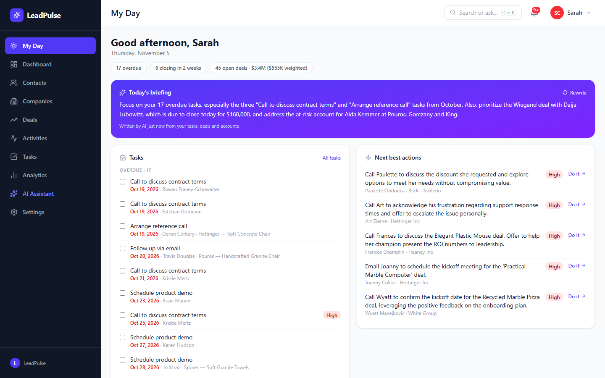
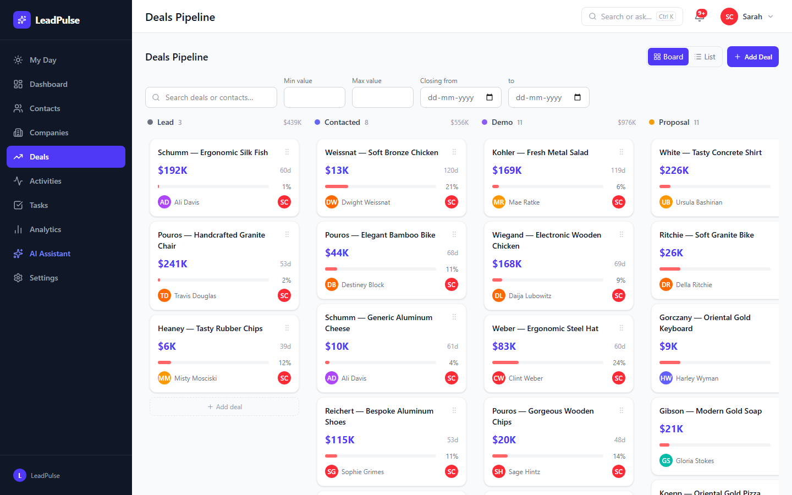
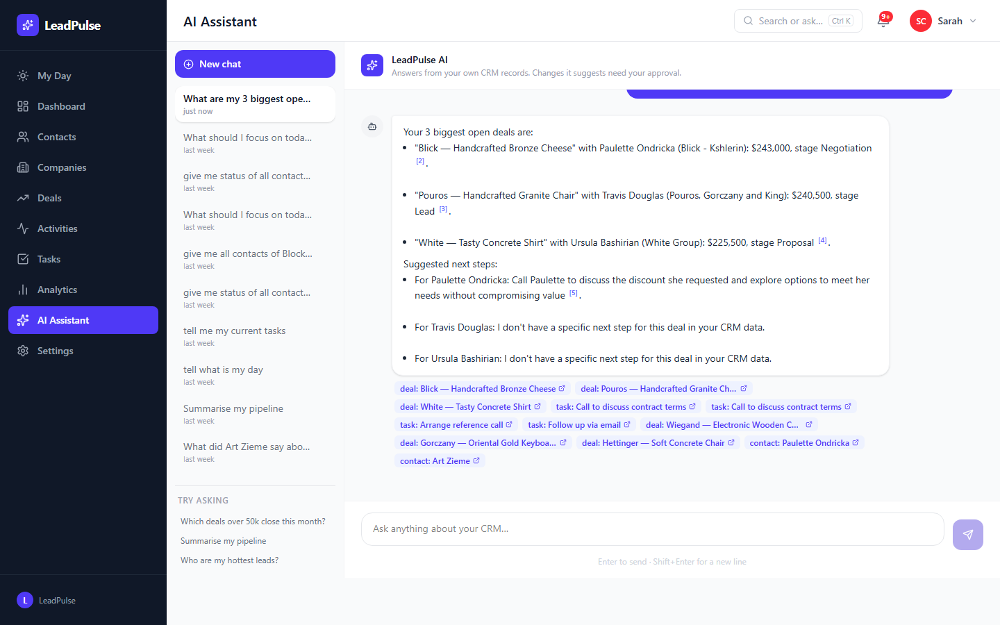
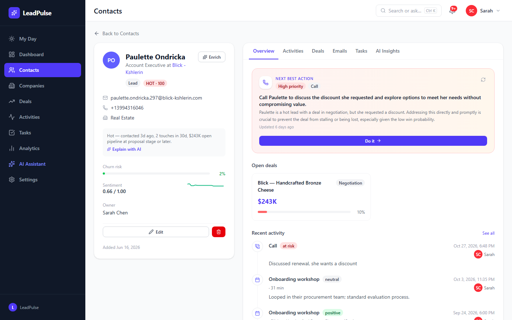
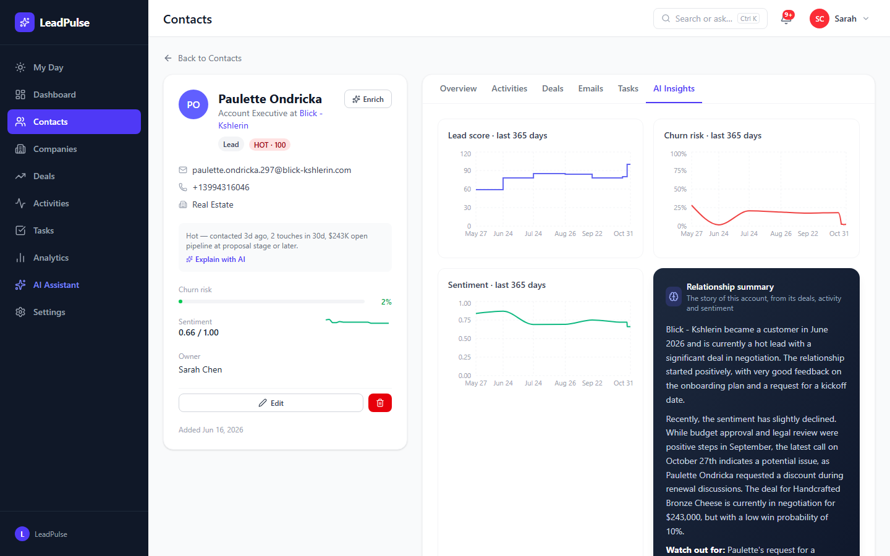
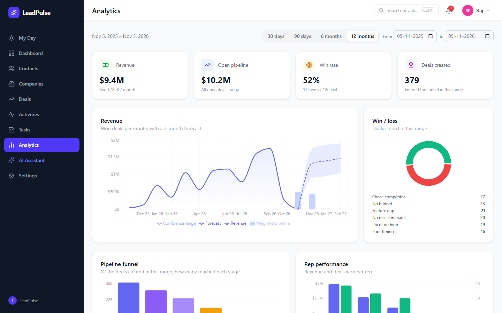
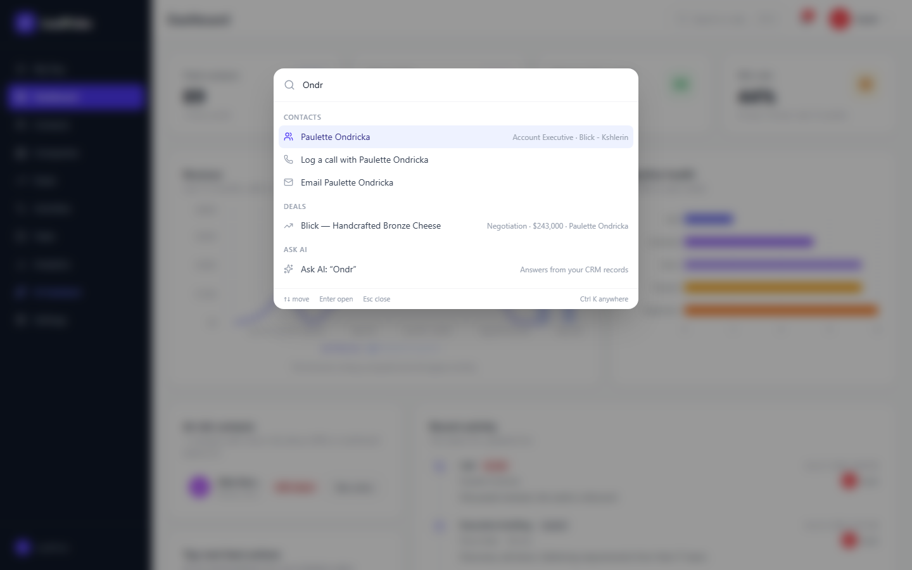
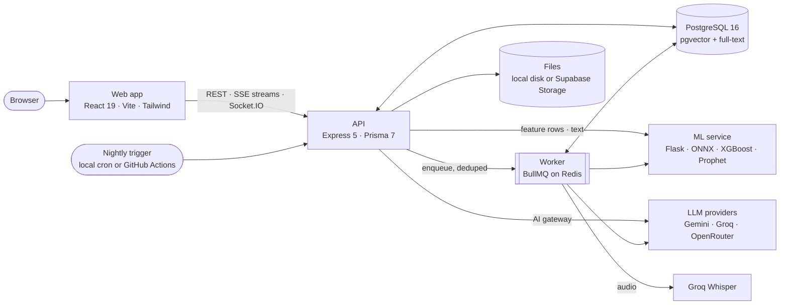

<div align="center">

# LeadPulse

### Know who to call. Know what to say. Know what's slipping.

**An AI-native CRM for small sales teams.**

Contacts, companies, a drag-and-drop pipeline, tasks and email in one place, with lead scoring, churn and win-probability models, call transcription, and an assistant that answers from your own records and cites them.

Every change the AI suggests waits for a person to approve it.

[](https://github.com/harshitvaish0110/leadpulse-crm/actions/workflows/ci.yml)


[Open the live app](https://leadpulse-crm.vercel.app) · [Quick start](#quick-start) · [Features](#features) · [How it works](#how-it-works) · [Deploy it for free](#deploy-it-for-free)

</div>

**Want to see how an AI-native CRM works under the hood?** Run the local demo. It comes with two years of synthetic sales history and five demo users, and runs on free AI keys, or on none at all in mock mode.

**Explore:** [Why LeadPulse?](#why-leadpulse) · [Who is it for?](#who-is-it-for) · [Screenshots](#see-it-in-action) · [AI you stay in control of](#ai-you-stay-in-control-of) · [Scores and models](#scores-and-models) · [What is real, and what is simulated?](#what-is-real-and-what-is-simulated) · [Development](#development-and-checks)



> **Try the live app:** sign in at [leadpulse-crm.vercel.app](https://leadpulse-crm.vercel.app) with **`sarah@leadpulse.dev`** and the password **`LeadPulse2026`**. Sarah is a sales rep with a full book of deals. It's a shared public account, so deleting records, uploading files, sending email and changing the password are switched off.
>
> The app runs on free hosting tiers, so the first request after a quiet spell can take about a minute while the servers wake up. For every role and feature, run it locally; that takes about five minutes.

## Why LeadPulse?

Most small teams run sales out of a spreadsheet and an inbox. The signals are all there: who went quiet, which deal has sat in Proposal for six weeks, what the customer actually said on the last call. Nobody has time to read it all, and a general-purpose chatbot doesn't know your pipeline.

LeadPulse connects those steps in one application:

- **Keep one record:** contacts, companies, deals, activities, tasks, emails and attachments, with stage history and an append-only audit trail.
- **Score what matters:** a transparent lead score from 0 to 120, churn risk and win probability from trained models, and sentiment on every logged conversation.
- **Start the day with a plan:** *My Day* lists what's overdue, what closes soon and what has stalled, plus a short briefing the AI writes overnight.
- **Ask in plain language:** the assistant runs safe, scoped database queries and a semantic search over your notes, then answers with links to the records it used.
- **Turn calls into records:** record or upload a call and get a transcript, a summary, action items, objections and a sentiment score.
- **Stay in control:** when the assistant suggests creating a task or moving a deal, that suggestion becomes an approval card. Nothing is written until someone approves it.

It was built as a full-stack project to explore what a CRM looks like when its AI is grounded in real data, scoped by role, and auditable. It suits learning, demos and small teams. It is not a replacement for Salesforce or HubSpot at enterprise scale.

## Who is it for?

| You are… | Try LeadPulse to… |
|---|---|
| A founder or small sales team | Run the pipeline, see who needs attention today, and log calls without typing up notes. |
| A sales manager | Watch the whole team's pipeline, forecast, win rate, win/loss reasons and at-risk accounts in one place. |
| A developer learning applied AI | Study a grounded assistant (RAG plus database tools), an LLM gateway with fallback, an approval gate and role-scoped data access in a working app. |
| A data or ML student | Inspect SQL feature views shared by training and serving, calibrated churn and win models with recorded metrics, ONNX inference and a revenue forecast. |

The demo workspace is synthetic and deterministic: 40 companies, 300 contacts, 466 deals, about 3,400 activities and 170 emails across 24 months. You don't need to connect anything for it to work.

## Features

### CRM

| Capability | What you can do |
|---|---|
| **Contacts** | Search, filter by status, owner, tags and score, sort by column, and bulk assign, tag, delete or export. Import a CSV and map its columns. Each contact page has six tabs: Overview, Activities, Deals, Emails, Tasks and AI Insights. |
| **Companies** | Browse accounts with their contacts, deals and pipeline value. |
| **Deal pipeline** | Kanban board with drag and drop (mouse or keyboard) and a list view. Filter by value and close date, and see days in stage, stage history, lost reasons and file attachments. |
| **Custom stages and fields** | Rename, add and reorder pipeline stages, each mapped to a base stage so the analytics stay consistent. Add custom fields to contacts and deals, and manage tags. |
| **Activities** | Log calls, meetings, emails and notes, or record a call in the browser. Anything with notes gets a sentiment label. |
| **Tasks** | List and calendar views with priorities. Due and overdue alerts arrive as notifications. |
| **Email workspace** | One thread per contact with sent mail, logged replies and drafts. Write, save and send from it. |
| **Dashboard and analytics** | KPIs, revenue with a three-month forecast and confidence band, pipeline health, funnel, win/loss reasons, rep performance and lead sources. |
| **Live updates** | Stage changes, new scores, transcripts and alerts arrive over Socket.IO, and each person receives only what their role lets them see. |
| **Command palette** | <kbd>Ctrl</kbd> + <kbd>K</kbd> (or <kbd>⌘</kbd> + <kbd>K</kbd>) finds any contact, deal or company, logs a call, starts an email, or sends a question to the assistant. |

### AI and machine learning

| Capability | What it does |
|---|---|
| **Assistant** | Answers questions about your CRM by combining up to two checked database queries (deals, contacts, tasks, pipeline totals) with a semantic search over notes, emails and transcripts. Sources appear as clickable chips. When the data isn't there, it says so. |
| **My Day briefing** | A short daily summary of overdue tasks, deals closing soon, stalled deals and at-risk accounts, written overnight or on demand. |
| **Next best action** | One concrete step per contact, such as call, email, meeting or task, with priority and reasoning. **Do it** opens the right form, already filled in. Refreshed nightly for the hottest contacts. |
| **Email composer** | Turns bullet points into a professional, friendly or concise email, streamed as it's written. |
| **Smart reply** | Replies to a customer's latest email in a professional, casual or urgent tone. |
| **Deal summary and relationship story** | A streamed briefing on a deal (background, concerns raised, last interaction, talking points) or on the whole history with a contact. |
| **Lead score** | A rule-based score from 0 to 120 with a one-line explanation, plus an optional longer explanation from the AI. |
| **Sentiment** | A DistilBERT model, run locally with ONNX, scores every activity. Each contact keeps a rolling average of its last ten scores. |
| **Churn risk and win probability** | Calibrated logistic regression for churn and XGBoost for win probability, rescored when data changes and every night. |
| **Revenue forecast** | Monthly forecast with Prophet, shown with a confidence band and the probability-weighted pipeline. |
| **Call transcription** | Groq Whisper transcribes the recording, and the AI extracts the summary, action items, objections, pricing mentions and next steps. |
| **Enrichment** | Fills in company details from a domain or LinkedIn URL. You see the changes side by side and confirm them before anything is saved. |

### Team and administration

| Capability | What you can do |
|---|---|
| **Roles** | `ADMIN`, `MANAGER` and `SALES_REP`. Reps see their own contacts and deals; managers and admins see everyone's. Companies are shared. |
| **Invites** | Invite-only sign-up with copyable invite links; the first admin is set by email. |
| **Public demo account** | Mark any login as a public demo with `DEMO_ACCOUNT_EMAILS`. Visitors can explore and edit, but can't delete, hand records to another owner, upload files, send email or change the account. |
| **Integrations** | Paste API keys in Settings (stored encrypted) and test each connection. Keys in `.env` take precedence. |
| **Webhooks** | Signed `contact.created`, `deal.stage_changed` and `task.overdue` events, retried with backoff. |
| **Audit log** | Settings, users and invites, integrations, webhooks, custom fields, contact deletions and bulk changes, enrichment, and every AI approval are recorded with before and after snapshots. The database itself rejects edits to the log. |

## See it in action

<table>
  <tr>
    <td width="50%"><br><sub><b>Pipeline.</b> Drag deals between stages and see days in stage and live win probability on each card.</sub></td>
    <td width="50%"><br><sub><b>Assistant.</b> Answers from database queries, with each deal, task and contact it used linked below.</sub></td>
  </tr>
  <tr>
    <td><br><sub><b>Contact.</b> Lead score with its reasons, churn risk, sentiment trend and the next best action.</sub></td>
    <td><br><sub><b>AI Insights.</b> A year of score, churn and sentiment history, and a streamed relationship summary.</sub></td>
  </tr>
  <tr>
    <td><br><sub><b>Analytics.</b> Revenue with a Prophet forecast and confidence band, win/loss reasons, funnel and rep performance.</sub></td>
    <td><br><sub><b>Command palette.</b> <kbd>Ctrl</kbd> + <kbd>K</kbd> to find anything, act on it, or ask the assistant.</sub></td>
  </tr>
</table>

## Quick start

**Prerequisites:** Git and Docker with Compose. Optionally, a free [Gemini](https://aistudio.google.com/apikey) or [Groq](https://console.groq.com) key for the AI features.

**1. Get the code and create your settings file:**

```bash
git clone https://github.com/harshitvaish0110/leadpulse-crm.git
cd leadpulse-crm
cp .env.example .env              # PowerShell: Copy-Item .env.example .env
```

**2. Choose how the AI runs.** Open `.env` and either paste `GEMINI_API_KEY` and/or `GROQ_API_KEY`, or set `AI_MOCK=true` to get canned AI responses with no key at all.

**3. Start everything and load the demo workspace:**

```bash
docker compose up --build -d      # Postgres, Redis, API, worker, ML service, web app
docker compose exec server npm run seed
```

The first build takes a few minutes, because the ML image downloads two small ONNX models.

Open **http://localhost:5173** and sign in with any demo account. The password is `password123`.

| Account | Role | Sees |
|---|---|---|
| `admin@leadpulse.dev` | Admin | Everything, plus settings, users and the audit log |
| `raj@leadpulse.dev` | Manager | The whole team's pipeline and analytics |
| `sarah@leadpulse.dev`, `emily@leadpulse.dev`, `mike@leadpulse.dev` | Sales rep | Their own contacts and deals |

Two optional one-time jobs fill in everything the nightly run would normally produce:

```bash
docker compose exec server npm run job -- reindex-all                  # the assistant's search index (no AI calls)
docker compose exec server npm run job -- nightly '{"force":true}'     # scores, next best actions, briefings, forecast
```

The nightly run makes about 25 AI calls for the next best actions and briefings. On free keys, that can use up Gemini Flash's daily quota; the rest of the run then falls back to Flash-Lite and Groq.

### A useful first walkthrough

1. **My Day** (as Sarah): read the briefing, tick off an overdue task, and click **Do it** on a next best action.
2. **Command palette:** press <kbd>Ctrl</kbd> + <kbd>K</kbd>, type part of a name, and choose *Log a call*.
3. **Contact page:** open a HOT contact and compare the score's explanation with its numbers. Then go to **AI Insights → Summarise the relationship**.
4. **Pipeline:** drag a deal to *Negotiation* and watch its win probability update. Open the deal for its streamed summary and stage history.
5. **Assistant:** ask *"What are my 3 biggest open deals, and what should I do next on each?"*, then *"Create a task to follow up with Paulette tomorrow"*. Approve or reject the card it shows.
6. **Call recording:** on a contact, log a call with the recorder, or upload a short audio file, and wait for the transcript and summary to appear.
7. **Manager view:** sign in as Raj and open **Analytics**: forecast, funnel, win/loss reasons and rep performance. Sign in as the admin for **Settings → Audit log**.

## From a sales call to the next step

LeadPulse does more than store data. One recorded call flows through the whole system:

```text
Record a call in the browser (or upload a file, up to 25 MB)
    → the API stores the audio, replies 202 and queues a transcription job
    → Groq Whisper transcribes it; the AI extracts summary, action items, objections and next steps
    → the ONNX sentiment model scores the summary; the contact's rolling sentiment updates
    → lead score, churn risk and win probability are recomputed
    → the transcript is indexed for the assistant; the owner's screen updates live
    → ask the assistant for a follow-up and it proposes a task
    → you approve the card; the task is created and the audit log records who approved it
```

Each slow step runs as a background job with a dedupe key, so the upload request never waits on it and the same work is never queued twice. With Redis, failed jobs are retried with backoff.

## AI you stay in control of

- **Approval before any write.** The assistant can propose four actions: create a task, log an activity, move a deal or draft an email. Each one is stored as a pending request and shown as a card. Only an approval runs it, through the same service code the UI uses, with the same permission checks.
- **Grounded answers.** CRM data goes into prompts inside clearly marked delimiters. Answers cite the records they draw on, and a question the data can't answer gets "I don't have that information" rather than a guess.
- **The same permissions as the UI.** Every query and search the assistant runs is scoped exactly like the page you'd open. A rep's assistant can't see another rep's deals.
- **Database tools, not generated SQL.** The planner picks from four fixed tools with typed, range-checked parameters. Unknown tools and parameters are dropped before anything runs.
- **Fallback without stuttering.** Calls go to Gemini Flash first, then Flash-Lite, Groq and OpenRouter (and Anthropic or OpenAI if you add a key). A failing provider is skipped for ten minutes, and one whose daily quota is spent is skipped until it resets. A streamed answer never switches provider halfway through.
- **Costs stay bounded.** Each user has a per-minute and per-day AI limit. Every call is logged with its provider, model, latency and token count. Closing the tab cancels the upstream request.
- **Testable without keys.** `AI_MOCK=true` swaps in a deterministic provider; CI and the end-to-end tests use it.

## How it works



- **Frontend:** React 19, Vite 8, Tailwind CSS 4, TanStack Query 5, Zustand, Recharts, dnd-kit and Socket.IO.
- **Backend:** Node.js 22, Express 5, Prisma 7 (pg adapter), BullMQ, Socket.IO and pino. Twenty-six tables, twelve migrations and about 120 endpoints.
- **ML service:** Flask and gunicorn, int8 ONNX models for sentiment and embeddings, scikit-learn, XGBoost and Prophet. About 380 MB of memory at peak, with no PyTorch.
- **Data:** PostgreSQL 16 with pgvector (an HNSW index) and full-text search (a GIN index); Redis for the job queue.

**Design choices worth knowing:**

- **One authorization choke point.** Every read and write, including AI, export and analytics, goes through a single `scopeFor(user, resource)` filter. Records outside your scope return 404, so their existence isn't revealed.
- **Hybrid retrieval.** The assistant's search runs a vector search and a full-text search, merges them with reciprocal rank fusion (k = 60), and keeps only rows whose source record the user can see.
- **Shared feature views.** Churn and win features come from two SQL views. Training reads them, and at serving time the API sends the same rows, so training and serving can't drift apart. The ML service needs no database access to serve.
- **Probabilities are 0–1 everywhere.** Only the UI multiplies by 100, and database CHECK constraints enforce the ranges.
- **Works without Redis.** Jobs then run inside the API process, which lets the whole app fit on free hosting. Adding Redis brings back retries and a separate worker.

## Scores and models

**Lead score (0–120).** Rule-based, so you can always see why a contact scored what it did.

| Signal | Points |
|---|---|
| Days since the last activity | 0–7 → 40 · 8–30 → 20 · more than 30, or none → 0 |
| Activities in the last 30 days | 1–3 → 10 · 4–10 → 20 · more than 10 → 30 |
| Open deal value | under $10k → 10 · $10k–$50k → 20 · over $50k → 30 |
| An open deal at Proposal or Negotiation | +20 |

**HOT** above 80 · **WARM** from 40 to 80 · **COLD** below 40.

**Sentiment** (probability that the text is positive): above 0.7 *positive* · 0.4–0.7 *neutral* · 0.2–0.4 *negative* · below 0.2 *at risk*. A contact counts as **at risk** when churn risk is above 0.6 or sentiment is below 0.3.

**Churn and win models**, as trained on the demo data and recorded in [`ml-service/models/metadata.json`](ml-service/models/metadata.json):

| Model | Features | Samples | ROC AUC | Brier |
|---|---|---|---|---|
| Churn: calibrated logistic regression | days since last contact, activity in the last 30 and 90 days, average sentiment, deal count and value, has an open deal | 262 | 0.89 | 0.094 |
| Win: XGBoost | furthest stage, value, days in stage, total and recent activity, contact seniority, company size | 323 | 0.71 | 0.225 |

These numbers describe the synthetic seed, not your customers. Retrain on real data with `docker compose exec ml-service python train.py`.

## What is real, and what is simulated?

| Component | Boundary |
|---|---|
| Demo workspace | Generated by a deterministic seed with deliberate patterns: churned contacts went quiet and soured, and won deals had more activity and more senior contacts. The companies, people and conversations are invented. |
| Churn and win models | Real models trained on that synthetic history. Their metrics show they learned its patterns; they are not a benchmark. |
| Sentiment and embeddings | Real pretrained models (DistilBERT SST-2, all-MiniLM-L6-v2), run locally. |
| AI features | Real calls to the configured providers. With `AI_MOCK=true` they return canned text. |
| Call transcription | Real Groq Whisper, which needs a Groq key. |
| Email sending | A test inbox (Ethereal) in development. Real delivery needs Resend or SMTP. |
| Enrichment | Clearbit if configured (untested). Otherwise the company website's public metadata plus an AI estimate with a confidence value, which you confirm before saving. |
| Forecast | Prophet on monthly won revenue: a guide, not a commitment. |
| Hosted app | Free tiers: services sleep when idle and take about a minute to wake, and the nightly job can start late. |

The assistant's answers are grounded and cited, but they can still be wrong. That's why every suggested change needs an approval.

## Security

- **Sessions:** a 15-minute access token held in memory only, plus a rotating, hashed, httpOnly refresh cookie. Logout and deactivation revoke sessions. A CSRF header is required on refresh.
- **Accounts:** invite-only. Passwords are hashed with bcrypt, and failed sign-ins are rate-limited per IP and email.
- **Secrets:** API keys entered in Settings are encrypted with AES-256-GCM. Keys, tokens and hashes are never logged or returned, and error responses never echo submitted values.
- **Outbound calls:** webhooks and enrichment go through an SSRF guard that blocks private addresses and re-checks every redirect. Webhooks are signed with HMAC-SHA256 over `timestamp.body`.
- **Files:** stored under random keys, downloaded through short-lived signed links, with type and size checks on upload.
- **Platform:** Helmet headers, an exact CORS allowlist, Socket.IO rooms joined on the server side only, per-user AI limits, and an audit log the database won't let anyone edit.

## Deploy it for free

The live app runs on free tiers, end to end:

| Piece | Host | Setup |
|---|---|---|
| Web app | Vercel | Root `client`, Vite preset, `VITE_API_URL` set to the API. [`client/vercel.json`](client/vercel.json) forwards `/api/auth/*` to the API, which keeps the refresh cookie first-party, and sends every other path to `index.html`. |
| API | Render web service (Node) | Root `server`. Build with `npm ci && npx prisma generate` and start with `npx prisma migrate deploy && node server.js`. Set `WORKER_INLINE=true`, `DB_POOL_MAX=5` and `NODE_VERSION=22`, and use `/health` as the health check. |
| ML service | Render web service (Docker) | Root `ml-service`, with `PORT=5001`, `FLASK_ENV=production` and `ML_SERVICE_TOKEN` set. |
| Database and files | Supabase | Connect through the session pooler (port 5432), use a private bucket, and set `STORAGE_DRIVER=supabase`. |
| Nightly jobs | GitHub Actions | [`nightly.yml`](.github/workflows/nightly.yml) wakes both services and triggers the run. It needs the `API_URL`, `ML_URL` and `INTERNAL_JOB_TOKEN` repository secrets, and keeps Supabase from pausing as a side effect. |

In production the API refuses to start without `JWT_SECRET`, `ML_SERVICE_TOKEN`, `INTERNAL_JOB_TOKEN` and `CORS_ORIGINS`. Generate a fresh secret for each environment with `node -e "console.log(require('crypto').randomBytes(32).toString('base64'))"`.

**Lessons from running it on free tiers:**
- Keep `DB_POOL_MAX` at 5 or less, because Supabase's free session pooler admits 15 clients by default.
- The client keeps retrying while a sleeping API wakes up, instead of showing an empty page.
- Change the seeded demo passwords as soon as the API is public. If you share a login, list it in `DEMO_ACCOUNT_EMAILS`.

## Configuration

Every setting is listed, with comments, in [`.env.example`](.env.example). The ones you're most likely to touch:

| Variable | Purpose |
|---|---|
| `GEMINI_API_KEY`, `GROQ_API_KEY`, `OPENROUTER_API_KEY` | AI providers, tried in order. One is enough; Groq also powers transcription. |
| `AI_MOCK` | `true` for canned AI responses with no keys (used by CI). |
| `DATABASE_URL`, `DB_POOL_MAX` | PostgreSQL connection and pool size. |
| `REDIS_URL`, `WORKER_INLINE` | Job queue. Leave `REDIS_URL` unset to run jobs inside the API. |
| `JWT_SECRET`, `ENCRYPTION_KEY`, `INTERNAL_JOB_TOKEN`, `ML_SERVICE_TOKEN` | Secrets. Use different values in each environment. |
| `CORS_ORIGINS`, `APP_URL` | Your web app's exact address, used for CORS and invite links. |
| `STORAGE_DRIVER`, `SUPABASE_*` | `local` disk or a private Supabase Storage bucket. |
| `EMAIL_DRIVER`, `RESEND_API_KEY` | `ethereal` (test inbox), `smtp` or `resend`. |
| `BOOTSTRAP_ADMIN_EMAIL`, `ALLOW_SIGNUP` | Who becomes the first admin, and whether open sign-up is allowed (off by default). |
| `DEMO_ACCOUNT_EMAILS` | Logins shared publicly as demos, with deletes, uploads, email sending and account changes switched off. |

## Development and checks

| Command | Purpose |
|---|---|
| `docker compose up --build -V -d` | Start everything. `-V` refreshes the `node_modules` volumes after dependency changes. |
| `cd server && npm test` | Server unit tests (scoring rules, query planning, crypto, the AI gateway and more). |
| `cd server && npm run test:integration` | API tests against a real PostgreSQL: permissions, sessions, the assistant, My Day, storage and webhooks. |
| `cd client && npm test && npm run lint` | Vitest and ESLint. |
| `cd client && npm run e2e` | Playwright journeys through the real UI, with the mock AI. |
| `cd ml-service && pytest -q` | ML service tests: endpoints, bands, features and the token check. |
| `cd server && npx prisma migrate reset --force && npx prisma generate && npm run seed` | Reset the local database to the demo workspace. |
| `docker compose exec ml-service python train.py` | Retrain the churn and win models and rewrite `metadata.json`. |

CI runs four jobs on every push and pull request:
- **server:** a migration guard, unit tests, then the integration suite on a seeded pgvector database;
- **ml:** pytest with the ONNX models cached;
- **client:** lint, tests and a production build;
- **e2e:** the API and web app started together and driven by Playwright.

**Repository layout**

```text
client/        React web app: pages, components, hooks, the SSE and formatting helpers, Playwright tests
server/        Express API, Prisma schema and migrations, the demo seed, background jobs, tests
ml-service/    Flask service: sentiment, embeddings, churn and win prediction, forecast, training script
.github/       CI and nightly workflows, README screenshots
```

## Roadmap

Workflow automations (when *this* happens, do *that*) · saved views and shared filters · one timeline across a contact's deals, emails and calls · a mobile layout · two-way Gmail and Outlook sync · an evaluation suite for the AI answers · retraining the models on live data · Redis and real email on the hosted demo.

These are future directions, not features that already exist.

## Contributing

Bug reports and ideas are welcome in [Issues](https://github.com/harshitvaish0110/leadpulse-crm/issues). Include the steps to reproduce and what you expected.

Pull requests should include tests and explain what changed and why. Please don't post API keys, tokens or real customer data in issues or pull requests.
